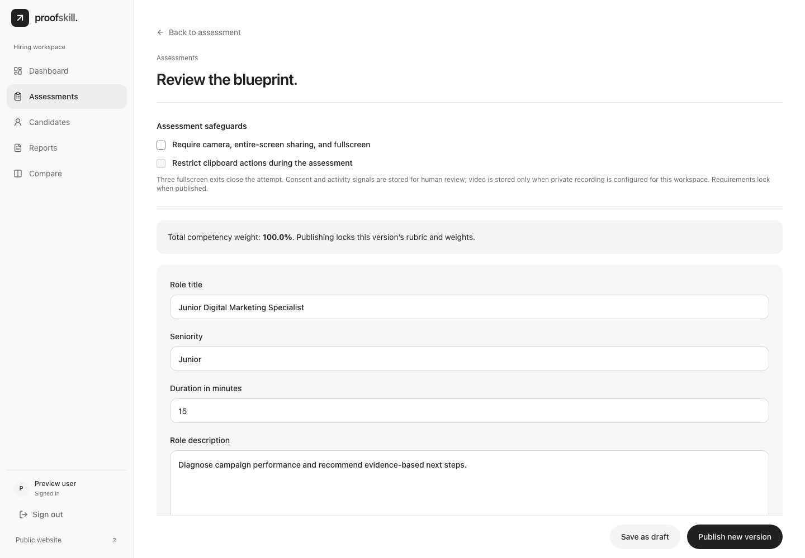
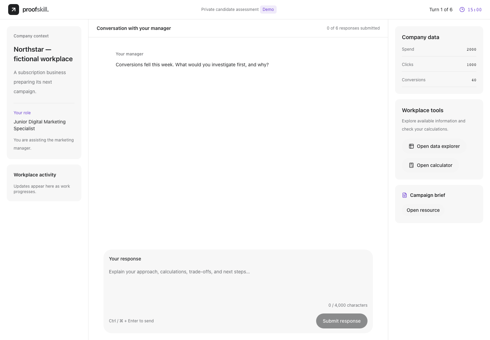
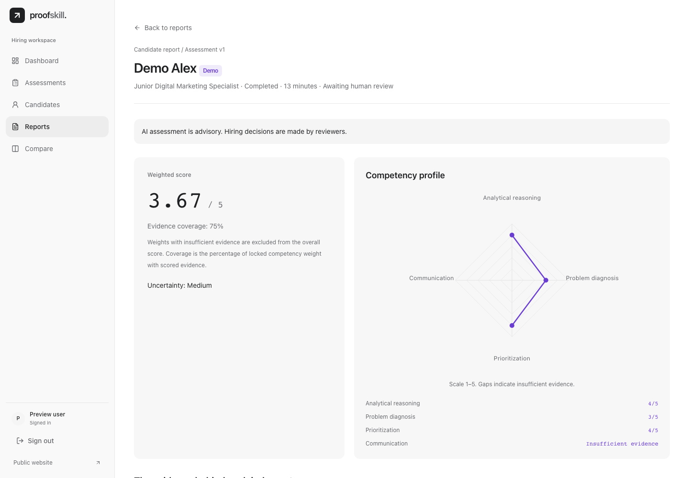

# ProofSkill

[](https://github.com/rashad-isayev/proofskill/actions/workflows/ci.yml)

ProofSkill lets hiring teams design workplace assessments, invite candidates into fictional simulations, and review the evidence behind each result.

| Design an assessment | Work through a simulation | Review the evidence |
| --- | --- | --- |
| [](screenshots/assessment.png) | [](screenshots/simulation.png) | [](screenshots/report.png) |

Screenshots use fictional fixtures. Reports support independent human review. ProofSkill is an experimental, source-only project for local evaluation, built with Next.js, React, TypeScript, and PostgreSQL.

Follow an assessment through the code in the [architecture guide](architecture.md).

## Copyright and contributions

All rights reserved for the original ProofSkill code. This repository grants no general license to use, redistribute, or adapt that code. GitHub's terms apply to viewing and forking the public repository on GitHub. For other uses, obtain written permission from the repository owner. Third-party components retain their own licenses. [GitHub's repository licensing guidance](https://docs.github.com/en/repositories/managing-your-repositorys-settings-and-features/customizing-your-repository/licensing-a-repository)

Pull requests are welcome under the [contribution policy](CONTRIBUTING.md).

## Try the local preview

If you have permission to run a local copy, use Node.js 24 and npm.

```sh
git clone https://github.com/rashad-isayev/proofskill.git
cd proofskill
```

From the repository root, install dependencies and start the preview.

```sh
npm ci
npm run build
npm run preview:frontend
```

Open `http://127.0.0.1:3201/enterprise`. The preview shows fictional assessments, candidates, and reports without requiring a database or AI provider key.

## Optional isolated local development

After installing dependencies with `npm ci`, the full workflow requires Docker Compose for a dedicated local PostgreSQL database and an AI provider key and model. Run the following commands from the repository root.

```sh
cp .env.example .env.local
```

Keep `.env.local` private. Set a newly generated local database password, use that same value in the localhost database URL, and generate a separate authentication secret with `openssl rand -hex 32`:

```env
PROOFSKILL_AUTH_DB_PASSWORD=<new-local-password>
AUTH_DATABASE_URL=postgresql://proofskill_auth:<url-encoded-local-password>@127.0.0.1:55432/proofskill_auth
BETTER_AUTH_URL=http://127.0.0.1:3000
BETTER_AUTH_SECRET=<new-random-secret-at-least-32-characters>
OPENAI_API_KEY=<your-dedicated-provider-key>
OPENAI_MODEL=<a-model-available-to-your-account>
OPENAI_BASE_URL=https://api.openai.com/v1
RECORDING_ENABLED=false
```

The angle-bracket values are placeholders. Do not reuse credentials or databases from another project. The provider is called from the server; never give secret settings a `NEXT_PUBLIC_` prefix. Optional `APP_DATABASE_URL` defaults to `AUTH_DATABASE_URL`.

```sh
docker compose --env-file .env.local -f compose.auth.yaml up -d --wait
npm run auth:migrate
npm run account:migrate
npm run hiring:migrate
npm run dev
```

Open `http://127.0.0.1:3000/auth/sign-up` to create a local HR account. Create and publish an assessment, add a fictional candidate, assign the assessment and open its private invitation in another browser context. Generation and adaptive replies require your configured provider. Provider failures are shown and saved drafts are preserved. Local application servers and Docker's database port bind to loopback by default.

## Checks

Install dependencies with `npm ci` first. Install Chromium and its system dependencies before running the browser suites.

```sh
npx playwright install --with-deps chromium
```

```sh
npm run lint
npm run build
npm run typecheck
npm run test:unit
npm run test:request-limits
npm run test:b2b
```

The frontend browser checks use fictional fixtures without provider credentials or a database. The build step generates the Next.js types used by `typecheck`.

Backend checks require a separate, migrated, disposable local database and a newly generated authentication secret. Configure its connection as `AUTH_DATABASE_URL` in your ignored `.env.local`. If `APP_DATABASE_URL` is set, it must also refer to disposable test data. Initialize this database with `auth:migrate`, `account:migrate`, and `hiring:migrate` before running the checks.

```sh
npm run test:hiring:database
npm run test:hiring:browser
```

The hiring browser suite starts a local mock provider and application server. Stop other processes using ports 3100, 3200, and 4105 before running the browser suites. Fixture passwords and invitation values are synthetic test data. The workflow in [CI](../.github/workflows/ci.yml) shows the complete disposable-database setup used on GitHub.

## Security and limitations

See [SECURITY.md](SECURITY.md). Source controls include server authorization, bounded request parsing, candidate-safe projections, isolated private/public AI calls, durable AI-call budgets, spreadsheet expansion limits and response security headers. The AI-budget tables are part of `hiring:migrate`; missing protection storage prevents provider calls.

Browser monitoring cannot lock an operating system or prove a physical capture state. Candidate consent and policy readiness are enforced at server boundaries, but client acknowledgments are not physical-device attestation. Local recording remains disabled by default; its development storage adapter refuses hosted production use. No retention policy or hosted recording service is supplied.

Published assessment policies and invitation tokens govern candidate access. Treat invitation URLs as private bearer credentials. Reports and candidate records require authorized HR access. Do not enter real personal data into a demonstration instance.

`vercel.json` disables automatic Git deployments and invokes a build guard that refuses hosted builds. This source release is not a deployment approval or a guarantee that the application is free of vulnerabilities. Future hosting needs a separate security/configuration review, dedicated credentials and data, HTTPS, storage/retention decisions and real-device/provider validation.
