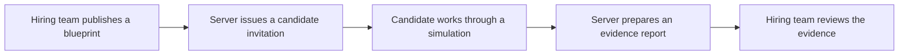

# ProofSkill architecture

ProofSkill turns a published assessment blueprint into a timed workplace simulation and an evidence report for a human reviewer. Next.js renders the two workspaces and handles API requests. PostgreSQL stores assessments, invitations, sessions, reports, and AI usage budgets.

## From invitation to review

1. **Publish an assessment.** A signed-in hiring user saves and publishes a blueprint with a role, duration, competencies, and weights. The published version fixes the rubric used for the attempt. Invitation creation checks that the assessment belongs to the user, is published, and matches the requested version. [Assessment and invitation storage](../lib/hiring/store.ts)
2. **Start the simulation.** The invitation URL carries a bearer token. The server resolves its hash to an invitation and binds the session to that invitation. The session keeps the assessment version, deadline, conversation, and private scenario state. Candidate requests can access their bound session while server-side checks enforce its lifecycle and monitoring policy. [Start endpoint](../app/api/simulations/start/route.ts) · [Simulation storage](../lib/hiring/store.ts)
3. **Respond to a workplace prompt.** The candidate sees a projection of the session with public facts, available resources, and the conversation. The server validates the response and checks the expected turn when supplied. A request ID lets the client retry a submitted turn safely. [Response endpoint](../app/api/simulations/respond/route.ts) · [Candidate projection](../lib/hiring/validation.ts)
4. **Review the evidence.** Completion evaluates the session against the locked competencies. Server-side code calculates weighted scores and coverage from the scored evidence. The candidate receives a submission acknowledgement. The owning hiring user can open the report, record notes, and make a decision. [Completion endpoint](../app/api/simulations/complete/route.ts) · [Report endpoint](../app/api/reports/%5Bid%5D/route.ts)

## Two boundaries worth inspecting

**Resource access lives on the server.** Hiring endpoints derive the owner from the authenticated session and apply it to database queries. Candidate endpoints bind the invitation token to the requested session. The report endpoint uses hiring authentication and ownership checks. Hiding a screen or guessing a record ID does not grant access. [API authentication and validation](../lib/hiring/http.ts) · [Ownership and session queries](../lib/hiring/store.ts)

**Private analysis and candidate-facing replies use separate model calls.** Private analysis receives the rubric and scenario state and returns structured evidence and proposed disclosures. The server validates that disclosures select stored facts. The reply call receives the candidate-visible world, conversation, validated disclosures, and a narrow follow-up task. Provider calls use database-backed usage and concurrency budgets. [AI orchestration](../lib/hiring/orchestration.ts) · [AI budgets](../lib/hiring/ai-budget.ts)

## Where to verify it

- [Hiring flow browser tests](../tests/hiring-browser/flow.spec.ts) exercise publishing, invitations, candidate work, and report review with a local mock AI provider.
- [Hiring security browser tests](../tests/hiring-browser/security.spec.ts) cover access isolation, request boundaries, and provider budgets.
- [The credential-free preview](../tests/b2b/harness/preview.mts) renders the workspaces with fictional fixtures. See the [README](README.md#try-the-local-preview) to run it and [SECURITY.md](SECURITY.md) for security controls and reporting.
